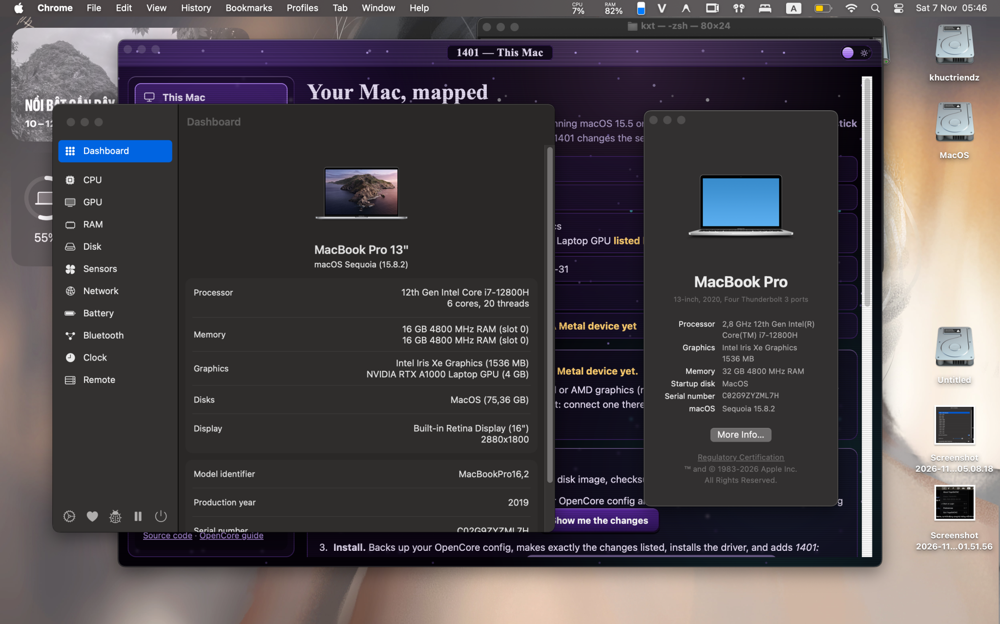

# OpenCore EFI for Lenovo ThinkPad P1 Gen 5
### Intel Core i7-12800H | Dual-GPU: Intel Iris Xe + NVIDIA RTX A1000 | macOS Sequoia 15.x & Tahoe

<p align="center">
  
</p>

[](https://github.com/acidanthera/OpenCorePkg)
[](https://www.apple.com/macos/)
[](https://github.com/khucxtriendev/WhateverXe)
[-purple.svg)](https://github.com/khucxtriendev/irisxegraphic-i712800h-efi/releases)

A production-grade OpenCore EFI configuration tailored specifically for the **Lenovo ThinkPad P1 Gen 5 (Type 21DDS88B00)**. 

This build achieves an extraordinary milestone: **Simultaneous Dual-GPU Multi-Monitor Acceleration on modern macOS**:
1. **Internal Panel (2560x1600 WQXGA):** Driven by **Intel Iris Xe Graphics (96 EU)** with QE/CI Metal 2 / Metal 3 acceleration via our patched [WhateverXe](https://github.com/khucxtriendev/WhateverXe).
2. **External Display (HDMI):** Directly wired to and driven by **NVIDIA RTX A1000 Laptop (Ampere)** with Metal 3 acceleration via [NullMoth's nvidia-macos-driver](https://github.com/nullmoth/nvidia-macos-driver).

Both displays work concurrently with fluid hardware acceleration!

---

## 1. Hardware Specifications

| Component | Detailed Specification |
| :--- | :--- |
| **Model** | Lenovo ThinkPad P1 Gen 5 (Type `21DDS88B00`) |
| **Processor (CPU)** | Intel Core i7-12800H (Alder Lake-H, 14 Cores / 20 Threads: 6 P-Cores up to 4.8 GHz + 8 E-Cores up to 3.7 GHz, 24MB L3 Cache, Display 13) |
| **Integrated GPU (iGPU)** | Intel Iris Xe Graphics (`8086:46A6`, 96 EU) — **Internal 2560x1600 eDP display with Metal 2 / Metal 3** |
| **Discrete GPU (dGPU)** | NVIDIA RTX A1000 Laptop (`10DE:25B9`, 4GB GDDR6 Ampere) — **External HDMI display with Metal 3** |
| **Internal Panel** | 16.0" 16:10 WQXGA (2560 x 1600), BOE `NE160QDM-NY1` / `LEN41B0` (eDP, 6-bpc GOP initialization) |
| **RAM** | 32GB (2 x 16GB) DDR5 4800MHz |
| **Storage** | NVMe SSD M.2 PCIe 4.0 x4 |
| **Audio** | Realtek ALC287 (`10EC:0287`, layout-id `11` via AppleALC) + Dolby Atmos stereo speakers |
| **Wireless & Bluetooth** | Intel Wi-Fi 6E AX211 160MHz (`AirportItlwm`) & Bluetooth 5.2 (`IntelBluetoothFirmware` + `IntelBTPatcher`) |
| **Input Devices** | Backlit ThinkPad Keyboard, TrackPoint + Precision Touchpad (`VoodooPS2Controller` + `VoodooI2C`) |
| **Power Management** | `HybridPM.kext` (XE-PM) + `CpuTopologyRebuild.kext` + `YogaSMC.kext` |

---

## 2. Feature Status

- [x] **Dual-GPU Multi-Monitor Acceleration:**
  - Internal 16.0" 2560x1600 display running on Intel Iris Xe (Metal 2 / Metal 3).
  - External HDMI monitor running directly on NVIDIA RTX A1000 (Metal 3).
- [x] **Display Backlight Brightness Control:** Smooth brightness slider for the internal panel via `SSDT-PNLF` and `BrightnessKeys.kext`.
- [x] **Hybrid CPU Power Management:** `HybridPM.kext` (XE-PM) combined with `-hpm` dynamically scales P-cores and E-cores, enabling proper C-states to keep temperatures cool (45°C–55°C idle).
- [x] **Audio Output:** Internal stereo speakers and 3.5mm headphone combo jack working via AppleALC (Realtek ALC287 `10EC:0287`, default `alcid=11`).
- [ ] **Internal Microphone:** ⚠️ **Currently NOT working / WIP** (The codec is Realtek ALC287. Default layout 11 works for stereo output. Alternative candidate layouts `13`, `21`, `66` can be tested via `alcid=N` in `boot-args` for microphone/jack combo troubleshooting; digital DMIC array may additionally require AppleISST).
- [x] **Wi-Fi & Bluetooth:** Connectivity across 2.4GHz / 5GHz / 6GHz networks and Bluetooth peripherals.
- [x] **Keyboard & Trackpad:** ThinkPad keyboard shortcuts, TrackPoint navigation, and multi-touch gestures.
- [x] **Battery & Power Monitoring:** ACPI battery percentage readout via `SMCBatteryManager.kext` + `ECEnabler.kext`.
- [ ] **Sleep & Wake:** ⚠️ **Currently NOT working / WIP** (Dual-GPU multi-head sleep requires further work synchronizing NVIDIA GSP firmware re-initialization and Intel Display 13 MBUS/DDB power wells upon wake).
- [ ] **Windows Hello IR Camera:** Unsupported by macOS.

> 📦 **Complete Kext Inventory & Version Guide:**
> For the complete inventory of all 35 kernel extensions included in this EFI, exact version numbers, bundle IDs, and why `VoodooPS2` & `VoodooI2C` are coordinated, refer to the [**Kext Reference & Version Inventory**](docs/KEXTS.md).

---

## 3. CPU Power Management: How to Use XE-PM (HybridPM)

Intel 12th Gen Alder Lake-H (`i7-12800H`) features a hybrid architecture combining **6 Performance cores (12 threads)** and **8 Efficient cores (8 threads)**. Because macOS Apple XCPM scheduler predates hybrid architectures, it natively misclassifies E-cores, ignores Intel Thread Director, and causes P-cores to run at elevated frequencies while keeping idle power consumption high (30W–45W at idle, 80°C–90°C).

This EFI employs **XE-PM** (originally discovered and developed by [JulioNectar](https://github.com/JulioNectar/Hackintosh-XPS13Plus-IrisXe-Tahoe), and ported into the standalone Lilu plugin `HybridPM.kext` by [Thatisjigen](https://github.com/Thatisjigen/HybridPM)) alongside `CpuTopologyRebuild.kext` to correct hybrid scheduling, HWP multiplier scaling (78.7 MHz mismatch), and deep C-states (C8/C10).

> 📖 **Comprehensive Technical Guide:**
> For an exhaustive architectural explanation, live `sysctl` runtime commands without rebooting, and custom power profiles, please see our dedicated [**XE-PM & Hybrid CPU Power Management Guide**](docs/XE-PM-GUIDE.md).
>
> 🔗 **Original Upstream Documentation:**
> * [JulioNectar XE-PM Guide: Full CPU Turbo & Lower Idle Power](https://github.com/JulioNectar/Hackintosh-XPS13Plus-IrisXe-Tahoe#new-full-cpu-turbo-and-lower-idle-power--ngreenpm-26-oct)
> * [Thatisjigen HybridPM Upstream Documentation](https://github.com/Thatisjigen/HybridPM#what-it-does)

### Active HybridPM Parameters in `config.plist`:
* **`-hpm`**: Activates the HybridPM Lilu plugin.
* **`-hpmbeta`**: Relaxes OS checks to allow running on newer macOS versions (Sequoia 15.x and Tahoe).
* **`hpmd3=1`**: Enforces package D3 state behavior for driverless PCI devices, drastically lowering idle draw.
* **`hpmepp=128`**: Sets the Energy Performance Preference (EPP) register to `128` (a balanced sweet-spot between performance and battery thermal efficiency, where `0` = maximum performance and `255` = maximum power saving).
* **`hpmpl1=45`**: Configures the sustained Power Limit 1 (PL1) ceiling to `45W`, matching the native TDP of the Intel Core i7-12800H.
* **`ctrsmt=full`**: Instructs `CpuTopologyRebuild.kext` to build an asymmetric core topology mapping so macOS correctly schedules background tasks to E-cores and high-priority threads to P-cores.

### Live Dynamic Power Tuning (No Reboot Required):
You can switch power modes instantly in Terminal:
```bash
# Maximum Performance (EPP 0):
sudo sysctl -w debug.hybridpm.epp=0

# Balanced / Daily Workflow (EPP 128 - Default):
sudo sysctl -w debug.hybridpm.epp=128

# Maximum Battery / Whisper Quiet (EPP 192):
sudo sysctl -w debug.hybridpm.epp=192
```

---

## 4. Comprehensive Boot-Args Analysis

Below is the complete breakdown of the boot arguments utilized in `config.plist`:

```text
-v debug=0x100 keepsyms=1 -allow3d -disablegfxfirmware -igfxdvmt ctrsmt=full amfi_get_out_of_my_way=0x1 amfi=0x80 ipc_control_port_options=0 revblock=pci,gmux revpatch=sbvmm,cpuname revcpu=1 -wex-reset-recover -wex-scanout-coherent -wex-hidpi-dbuf alcid=11 -hpm -hpmbeta hpmd3=1 hpmepp=128 hpmpl1=45 nvfb=1 nvaccel=1 nvfbheads=4 -nvkmsnosmooth nvfbhidpi=1
```

### Breakdown by Subsystem:

| Argument | Category | Purpose |
| :--- | :--- | :--- |
| `-v` | Diagnostic | Enables verbose boot mode for hardware logging and troubleshooting. |
| `debug=0x100` | Kernel | Prevents automatic reboot upon kernel panic, allowing inspection of the panic log. |
| `keepsyms=1` | Kernel | Retains kernel debug symbols in panic backtraces. |
| `-allow3d` | WhateverXe | Enables 3D hardware acceleration for Intel Xe integrated graphics. |
| `-disablegfxfirmware` | WhateverXe | Prevents loading Apple's incompatible proprietary GPU firmware on Alder Lake Xe. |
| `-igfxdvmt` | WhateverXe | Enables DVMT stolen memory patching for Intel Xe. |
| `-wex-reset-recover` | WhateverXe | Saves and restores render engine MOCS/L3 cache tables across GPU hang resets. |
| `-wex-scanout-coherent`| WhateverXe | Treats flipped display surfaces as displayable for coherent MOCS caching. |
| `-wex-hidpi-dbuf` | WhateverXe | Allocates 96 DBUF blocks for cursor and primary planes, preventing HiDPI scaling glitches. |
| `amfi_get_out_of_my_way=0x1` | Security | AMFIPass parameter bypassing AMFI code-signing checks for third-party graphics bundles. |
| `amfi=0x80` | Security | Relaxes AMFI signature enforcement for unapproved user-space drivers. |
| `ipc_control_port_options=0` | Kernel | Relaxes mach port IPC restrictions required for custom Metal bundles. |
| `ctrsmt=full` | CPU Topology | Configures full asymmetric SMT topology for Alder Lake 6P + 8E cores. |
| `revblock=pci,gmux` | RestrictEvents | Blocks GMUX and PCI validation checks. |
| `revpatch=sbvmm,cpuname` | RestrictEvents | Enables Software Update VMM patching and CPU brand string override. |
| `revcpu=1` | RestrictEvents | Enables custom CPU topology display in macOS System Settings. |
| `-hpm` | XE-PM | Activates JulioNectar's Hybrid CPU Power Management plugin. |
| `-hpmbeta` | XE-PM | Permits XE-PM execution on macOS Sequoia and Tahoe. |
| `hpmd3=1` | XE-PM | Enables package D3 low-power states. |
| `hpmepp=128` | XE-PM | Sets balanced Energy Performance Preference (EPP). |
| `hpmpl1=45` | XE-PM | Configures 45W long-term TDP power limit for i7-12800H. |
| `nvfb=1` | NullMoth | Enables NullMoth NVIDIA Framebuffer (NVRMFB) driver. |
| `nvaccel=1` | NullMoth | Enables NullMoth NVIDIA Hardware Acceleration (NVAccel). |
| `nvfbheads=4` | NullMoth | Configures 4 display heads for the NVIDIA RTX A1000. |
| `-nvkmsnosmooth` | NullMoth | Disables KMS smooth-stepping transitions on NVIDIA display ports. |
| `nvfbhidpi=1` | NullMoth | Enables HiDPI scaling support on displays attached to the NVIDIA card. |
| `alcid=11` | Audio | Sets AppleALC layout ID 11 for Realtek ALC287 (`10EC:0287`). Test `alcid=13` or `21` for mic/combo troubleshooting. |

---

## 5. Sleep & Wake: Current Limitations & Workaround

> [!WARNING]
> **Sleep & Wake is currently in development and NOT yet functional on this dual-GPU setup.**
> Attempting to sleep the machine can lead to black screens, kernel panics on wake, or disconnected HDMI links.

### Why Sleep/Wake Fails on Dual-GPU Hackintosh:
1. **NVIDIA GSP Firmware Wake:** The NVIDIA Ampere architecture relies on GSP (GPU System Processor) firmware. When waking from S3/Modern Standby, the GSP firmware must be completely cold-booted and reloaded by `NVRM.kext`. Modern macOS lacks native handling for discrete NVIDIA sleep/wake cycles.
2. **Display 13 Pipe Desynchronization:** WhateverXe must reprogram MBUS, Pipe DDB, and clock gates upon wake. When two independent GPU drivers (Intel + NVIDIA) attempt to wake simultaneously, display handoff can stall.

### Recommended System Settings to Prevent Sleep:
To prevent unexpected panics while sleeping, configure macOS power management in Terminal:

```bash
sudo pmset -a disablesleep 1
sudo pmset -a sleep 0
sudo pmset -a displaysleep 15
sudo pmset -a hibernatemode 0
```
*(This allows the display to turn off after 15 minutes of inactivity while keeping the system awake and stable).*

---

## 6. Complete Step-by-Step Installation Procedure

To achieve a fully functional dual-GPU setup, follow these phases in order:

### Phase 0: Lenovo ThinkPad BIOS Configuration (Crucial: Hybrid Graphics)
Before booting the installer, press **F1** or **Enter** at the Lenovo splash screen to enter the UEFI BIOS Setup and configure the following options:

* ⚠️ **Config -> Display -> Graphics Device:** Set to **`Hybrid Graphics`** *(MANDATORY)*
  * **DO NOT** select *Discrete Graphics only*: This disables the Intel Iris Xe GPU at the ACPI/PCIe level, preventing the internal 2560x1600 eDP screen from initializing.
  * **DO NOT** select *Integrated Graphics only*: This cuts power to the NVIDIA RTX A1000, disabling external HDMI video output.
  * **Hybrid Graphics** keeps both GPUs accessible so WhateverXe drives the internal panel and NullMoth drives the external HDMI monitor.
* **Security -> Secure Boot:** `Disabled`
* **Security -> Intel Total Memory Encryption (TME):** `Disabled`
* **Startup -> Fast Boot:** `Disabled`
* **Security -> Virtualization -> Intel Virtualization Technology (VT-x):** `Enabled`
* **Security -> Virtualization -> Intel VT-d:** `Enabled`
* **Config -> Thunderbolt 4 / USB4:** Leave at factory defaults (on 12th Gen ThinkPad P1 Gen 5, Thunderbolt 4 is integrated directly into the Intel SoC, so legacy "BIOS Assist Mode" is either not present or already disabled by default).

### Phase 1: Prepare the USB Installer via NullMoth 1401
1. Download the **1401 installer tool** from [nullmoth/1401](https://github.com/nullmoth/1401).
2. Use the 1401 application to create a bootable macOS USB installer.
3. The USB partition will be formatted as FAT32 with the volume label **`1401`**.

### Phase 2: Fresh macOS Installation
1. Boot the ThinkPad P1 Gen 5 by pressing **F12** at startup and selecting the `1401` USB drive.
2. Complete the standard macOS installation (Sequoia 15.x / Tahoe) onto your internal NVMe SSD.
3. Once at the macOS Desktop, complete the initial post-install environment setup prompted by 1401.

### Phase 3: Install NullMoth NVIDIA Driver (External HDMI Display)
1. Download the latest driver package from [NullMoth NVIDIA macOS Driver Releases](https://github.com/nullmoth/nvidia-macos-driver/releases).
2. Install the package inside macOS to deploy the NVIDIA kernel extensions (`NVRM.kext`, `NVAccel.kext`) and the Metal user-space bundle (`/Library/GPUBundles/NVMTLDriver.bundle`).
3. ⚡ **Configure NVIDIA to "Armed-Only" Mode (Crucial Power & CPU Optimization):**
   When using the laptop on battery or solely with the internal laptop display, background macOS applications could unnecessarily route Metal commands across the PCIe bus to the NVIDIA dGPU, spiking CPU usage and draining battery.
   To lock the NVIDIA driver into "Armed-Only" mode (only activating when an external display is connected), run this command in Terminal:
   ```bash
   sudo sh -c 'echo "!*" > /Library/GPUBundles/nvmtl-allow.txt'
   ```
4. ⚠️ **HDMI External Monitor Connection Note (Cold-Plug Required):**
   * If you wish to use the discrete card and external monitor, **plug in the HDMI cable BEFORE powering on or booting into macOS**.
   * On modern macOS Hackintosh systems with discrete NVIDIA Ampere cards, HDMI display heads must be initialized during early boot. Hotplugging HDMI *after* macOS has already booted may fail to wake the display output until a reboot with the cable plugged in.

---

### Phase 4: Install Intel Iris Xe Graphics Post-Install
To enable 3D Metal hardware acceleration on the internal 16.0" 2560x1600 eDP screen, install the WhateverXe graphics bundle and JulioNectar's `impostor.dylib` bridge.

You can choose either the automated script or the manual terminal method:

#### Option A: Automated Script (Recommended)
1. Ensure the `postinstall_tools` folder from this repo is placed on your USB drive (volume `1401`).
2. Open Terminal and run:
   ```bash
   sudo bash /Volumes/1401/postinstall_tools/install_iris_xe.sh
   ```
   *This automated script downloads and installs `WhateverXe-Graphics-0.4.0.pkg`, injects `impostor.dylib` into `/Library/GPUBundles`, applies `root:wheel` permissions, and rebuilds the AuxKC kernel cache.*

#### Option B: Manual Installation
If you prefer executing the steps manually:
1. Download and install [WhateverXe-Graphics-0.4.0.pkg](https://github.com/b00t0x/WhateverXe-Graphics/releases/download/v0.4.0/WhateverXe-Graphics-0.4.0.pkg):
   ```bash
   sudo installer -pkg WhateverXe-Graphics-0.4.0.pkg -target /
   ```
2. Copy JulioNectar's `impostor.dylib` into the Intel Metal graphics bundle:
   ```bash
   sudo cp postinstall_tools/impostor.dylib /Library/GPUBundles/AppleIntelTGLGraphicsMTLDriver.bundle/Contents/MacOS/impostor.dylib
   sudo chmod 755 /Library/GPUBundles/AppleIntelTGLGraphicsMTLDriver.bundle/Contents/MacOS/impostor.dylib
   sudo codesign -f -s - -i impostor /Library/GPUBundles/AppleIntelTGLGraphicsMTLDriver.bundle/Contents/MacOS/impostor.dylib
   ```
3. Set proper system permissions:
   ```bash
   sudo chown -R root:wheel /Library/GPUBundles /Library/Extensions
   sudo chmod -R 755 /Library/GPUBundles /Library/Extensions
   ```
4. Rebuild the Auxiliary Kernel Collection (AuxKC):
   ```bash
   sudo kmutil install --volume-root / --update-all
   ```

---

### Phase 5: Deploy This EFI to Internal SSD & Final Reboot
Now that both NVIDIA and Intel drivers are properly installed in `/Library`, deploy this OpenCore EFI to your internal NVMe SSD so the laptop can boot standalone:

1. Download **`EFI-ThinkPad-P1-Gen5-IrisXe-Nvidia-v1.0.zip`** from [Releases](https://github.com/khucxtriendev/irisxegraphic-i712800h-efi/releases) (or grab the `EFI` folder from this repo).
2. Mount the EFI partition (ESP) of your internal SSD using **MountEFI** or Terminal:
   ```bash
   # Identify your internal SSD EFI disk identifier (e.g. disk0s1):
   diskutil list
   sudo diskutil mount /dev/disk0s1
   ```
3. Copy the **`EFI`** folder into the root of the mounted EFI volume (`/Volumes/EFI/`).
4. Safely unmount the EFI volume and remove the USB installer drive:
   ```bash
   diskutil unmount /Volumes/EFI
   ```
5. *(Optional)* If using an external monitor, plug in the HDMI cable now.
6. Reboot your ThinkPad:
   ```bash
   sudo reboot
   ```

---

## 7. Verification

After rebooting, open **Terminal** and verify both GPUs:

```bash
system_profiler SPDisplaysDataType
```

* **Expected Result:**
  * **Intel Iris Xe Graphics:** Driving the internal 16.0" 2560x1600 eDP panel (`Metal Support: Metal 2` or `Metal 3`).
  * **NVIDIA RTX A1000 Laptop:** Driving the external HDMI monitor (`Metal Support: Metal 3`).
* Both displays run simultaneously with fluid 60 FPS hardware acceleration!

---

## 8. Upstream Credits & Acknowledgments

* **[khucxtriendev/WhateverXe](https://github.com/khucxtriendev/WhateverXe):** WhateverXe fork patched for Lenovo ThinkPad UEFI GOP 6-bpc (`0x8a200106`), eDP panel preservation during Type-C unreadiness, and physical register verification preventing `tryCloseGate()` black screens.
* **[nullmoth/1401](https://github.com/nullmoth/1401) & [nullmoth/nvidia-macos-driver](https://github.com/nullmoth/nvidia-macos-driver):** The breakthrough NVIDIA modern macOS driver and installer app enabling NVIDIA Ampere/Turing dGPUs on macOS with Metal 3.
* **[b00t0x/WhateverXe](https://github.com/b00t0x/WhateverXe) & [b00t0x/WhateverXe-Graphics](https://github.com/b00t0x/WhateverXe-Graphics):** Foundational Intel Xe graphics adaptation layer on macOS.
* **[Thatisjigen/WhateverXe](https://github.com/Thatisjigen/WhateverXe) & [Thatisjigen/HybridPM](https://github.com/Thatisjigen/HybridPM):** Display 13 eDP research, upstream WhateverXe mobile tree, and standalone `HybridPM.kext` port for hybrid Intel power management.
* **[JulioNectar/Hackintosh-XPS13Plus-IrisXe-Tahoe](https://github.com/JulioNectar/Hackintosh-XPS13Plus-IrisXe-Tahoe):** Pioneer of Intel Iris Xe Metal driver adaptation, `impostor.dylib` (`xefix`), and original XE-PM hybrid core power management discovery on macOS Tahoe/Sequoia.
* **[Acidanthera](https://github.com/acidanthera):** OpenCorePkg, Lilu, VirtualSMC, AppleALC, RestrictEvents, AMFIPass, etc.
* **[OpenIntelWireless](https://github.com/OpenIntelWireless):** AirportItlwm and IntelBluetoothFirmware.

---

## 9. Pre-Packaged Release

For immediate deployment, download the ready-to-use EFI archive from GitHub Releases:
* 📦 **[Download EFI-ThinkPad-P1-Gen5-IrisXe-Nvidia-v1.0.zip](https://github.com/khucxtriendev/irisxegraphic-i712800h-efi/releases)**
