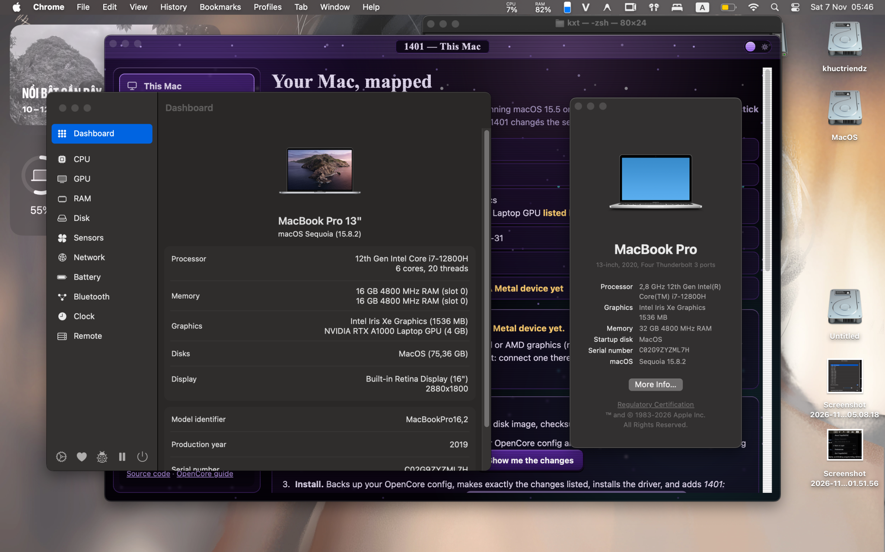

# Comprehensive Guide to XE-PM & Hybrid CPU Power Management
### Intel Core i7-12800H (Alder Lake-H) on macOS Sequoia & Tahoe

---

## 1. Upstream Guides & Reference Repositories

This implementation directly utilizes the pioneering discoveries and code from the following projects:

* **Original XE-PM Discovery & Implementation:** [JulioNectar/Hackintosh-XPS13Plus-IrisXe-Tahoe](https://github.com/JulioNectar/Hackintosh-XPS13Plus-IrisXe-Tahoe)
  * Read the original breakthrough research: [JulioNectar XE-PM Guide: Full CPU Turbo & Lower Idle Power](https://github.com/JulioNectar/Hackintosh-XPS13Plus-IrisXe-Tahoe#new-full-cpu-turbo-and-lower-idle-power--ngreenpm-26-oct).
* **Standalone Lilu Plugin Port (HybridPM):** [Thatisjigen/HybridPM](https://github.com/Thatisjigen/HybridPM)
  * Read the upstream standalone plugin guide: [Thatisjigen HybridPM Documentation](https://github.com/Thatisjigen/HybridPM#what-it-does).

---

## 2. The Core Problem with Alder Lake / Raptor Lake on macOS

Intel 12th Gen Alder Lake (`i7-12800H`) features a hybrid architecture combining **6 Performance cores (12 threads)** and **8 Efficient cores (8 threads)**. 

Because macOS Apple XCPM power management predates hybrid CPUs, it causes severe issues out of the box:

1. **P-Cores Stuck at Lower Turbo (~3.8 GHz instead of 4.8 GHz):**
   * Apple XCPM writes `IA32_HWP_REQUEST` in standard 100 MHz units.
   * However, Intel hybrid P-cores compute HWP performance in approximately **78.7 MHz units**. As a result, when macOS requests "5.0 GHz", the hardware actually receives ~3.9 GHz.
   * Furthermore, macOS default Energy Performance Preference (EPP 128) clips single-core turbo on Alder Lake mobile parts, and "energy-efficient turbo" holds back the top multiplier bins.
2. **Deep Idle C-States Disabled (Overheating & Battery Drain):**
   * Apple XCPM's idle table for spoofed Intel CPUs disables deep sleep states **C8 and C10** and requests **C3**, which 12th Gen silicon does not possess.
   * As a result, the CPU cores never sleep deeper than C6, keeping unneeded cores powered up and consuming **30W–45W at idle**, causing the laptop to run hot (80°C–90°C) with fans spinning continuously.

---

## 3. How XE-PM (HybridPM) Solves This

20 seconds after Lilu starts (and re-verified at 60 seconds), **XE-PM (`HybridPM.kext`)** hooks Apple XCPM and performs the following corrections:

1. **HWP Frequency Translation:** Corrects the 100 MHz vs 78.7 MHz unit mismatch on all hybrid P-cores, restoring full 4.8 GHz single-core turbo boost.
2. **EPP Optimization:** Replaces the conservative 0x80 EPP with a user-tunable profile (`hpmepp=N`).
3. **Disables Energy-Efficient Turbo:** Clears MSR `0x1FC` bit 19 to unlock top bin frequencies during peak loads.
4. **Enables C8 & C10 Idle States:** Rewrites the XCPM C-state table to enable C8 and C10 deep sleep states while disabling the nonexistent C3.
5. **D3hot Power Down for Driverless PCI Devices:** Puts unmanaged PCI blocks (IPU camera, GNA, ISH, DPTF, Thunderbolt DMA) into low-power D3hot state when `hpmd3=1` is passed.
6. **Sustained Power Ceiling (PL1):** Enforces a sustained thermal power ceiling via `hpmpl1=W` (defaulted to 45W for the i7-12800H).

### Real-World Results:
* **Idle Package Power:** Drops from **~35W down to 3W–6W**.
* **Idle Temperatures:** Drops from **80°C–90°C down to 40°C–50°C**.
* **Single-Core Geekbench Scores:** Improves by **+30% to +35%**.

---

## 4. Boot-Args Reference & Tuning Profiles

In `config.plist -> NVRAM -> Add -> 7C436110-AB2A-4BBB-A880-FE41995C9F82 -> boot-args`:

```text
-hpm -hpmbeta hpmd3=1 hpmepp=128 hpmpl1=45 ctrsmt=full
```

### Argument Details:

| Argument | Function | Default in this EFI |
| :--- | :--- | :--- |
| **`-hpm`** | Activates the HybridPM Lilu plugin. | **Required** |
| **`-hpmbeta`** | Relaxes macOS build version check for Sequoia & Tahoe. | **Required** |
| **`hpmd3=1`** | Forces driverless PCI devices into low-power D3hot. | `1` |
| **`hpmepp=N`** | Energy Performance Preference (`0` = Max Performance, `255` = Max Battery Saving). | `128` |
| **`hpmpl1=W`** | Long-term Power Limit 1 in Watts. | `45` |
| **`ctrsmt=full`** | Tells `CpuTopologyRebuild.kext` to build full asymmetric core topology. | **Required** |

### Recommended Profiles:

#### Profile A: Balanced (Default — Highly Recommended)
Ideal for everyday productivity, software development, and multitasking:
```text
-hpm -hpmbeta hpmd3=1 hpmepp=128 hpmpl1=45 ctrsmt=full
```

#### Profile B: Ultra-Quiet & Maximum Battery (On-the-go / Coffee Shop)
Prioritizes lower temperatures and silent fan operation:
```text
-hpm -hpmbeta hpmd3=1 hpmepp=192 hpmpl1=35 ctrsmt=full
```

#### Profile C: Peak Performance (Plugged into A/C power, rendering / compilation)
Unlocks maximum single-core and multi-core performance:
```text
-hpm -hpmbeta hpmd3=1 hpmepp=0 hpmpl1=60 ctrsmt=full
```

---

## 5. Live Runtime Tuning via Sysctl (No Reboot Required!)

HybridPM exposes live kernel `sysctl` knobs that allow you to adjust power profiles on the fly without rebooting:

### 1. Change EPP Live:
```bash
# Switch to Max Performance (EPP 0):
sudo sysctl -w debug.hybridpm.epp=0

# Switch to Balanced (EPP 128):
sudo sysctl -w debug.hybridpm.epp=128

# Switch to Max Battery Saving (EPP 192):
sudo sysctl -w debug.hybridpm.epp=192
```

### 2. Toggle C-States Live:
```bash
# Disable C8/C10:
sudo sysctl -w debug.hybridpm.cst=0

# Re-enable C8/C10:
sudo sysctl -w debug.hybridpm.cst=1
```

### 3. Read Live Sensors & Status:
```bash
sysctl -a | grep -i hybridpm
```

---

## 6. How to Verify XE-PM Operation

### Terminal Verification:
```bash
# 1. Verify kext is loaded into the kernel:
kextstat | grep -i HybridPM

# 2. Inspect kernel boot log for HPM initialization:
sudo dmesg | grep -i hpm
```

### Visual Monitoring via GUI:
Install the open-source monitoring tool **[Stats](https://github.com/exelban/stats)** or **Intel Power Gadget**:



1. When the laptop is idling (no heavy apps running):
   * **CPU Frequency:** Should ramp down to **800 MHz – 1.4 GHz**.
   * **Package Power:** Should drop to **3W – 6W** (as pictured above).
   * **CPU Temperature:** Should stabilize at **40°C – 50°C** with silent fans.
2. Under heavy single-threaded load:
   * Clock speed should smoothly boost to **4.6 GHz – 4.8 GHz**.
